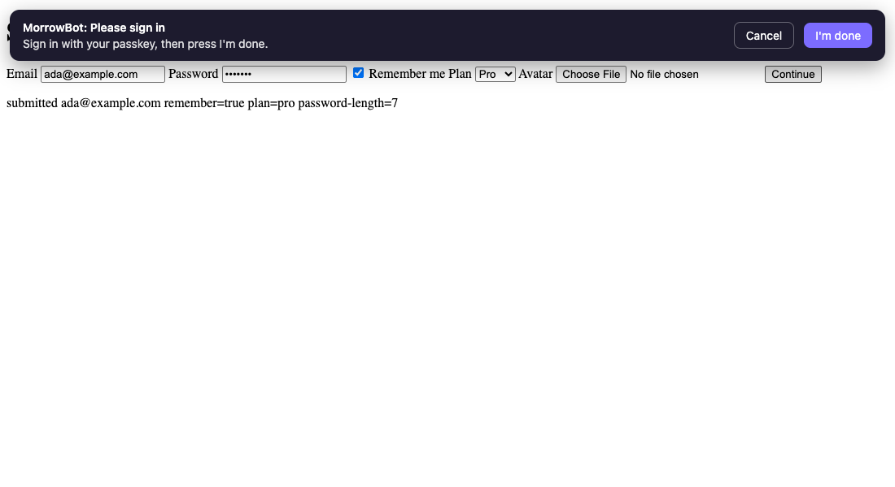
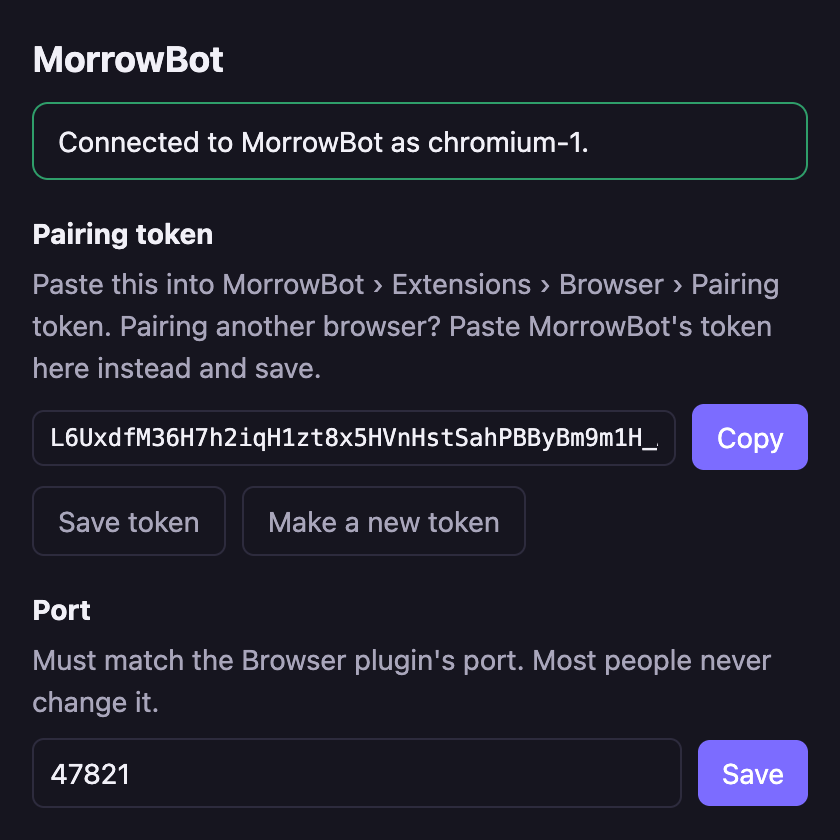

# Ori Bot browser extension

Lets Ori Bot agents use your real browser: list, open, switch and close tabs; navigate; read the
page as an accessibility tree with element refs; click, type, fill forms, pick options, hover,
scroll, drag, upload files, answer dialogs and take screenshots. For logins, 2FA, payments and
CAPTCHAs the agent hands the tab to you with a banner and waits until you press **I'm done**.



One Manifest V3 build works in Chrome, Brave, Edge, Arc, Dia, Vivaldi, Opera and other Chromium
browsers (116 or newer).

## Build

```sh
npm ci
npm run build -w apps/browser-extension   # writes apps/browser-extension/dist/
```

## Load it (unpacked)

1. Open the extensions page: `chrome://extensions` (Brave `brave://extensions`, Edge
   `edge://extensions`; Arc, Dia, Vivaldi and Opera use `chrome://extensions` too).
2. Turn on **Developer mode**.
3. Press **Load unpacked** and pick `apps/browser-extension/dist`.
4. For file uploads, open the extension's **Details** and turn on **Allow access to file URLs**, and
   choose an **upload folder** in Ori Bot's Browser plugin settings. Agents can upload only files
   inside it; uploads are off until you choose one.

After a rebuild, press the reload button on the extension's card.

## Pair it with Ori Bot

1. Click the Ori Bot icon in the toolbar. It shows a **pairing token**; press **Copy**.
2. In Ori Bot, open **Extensions › Browser** and paste it into **Pairing token**.
3. The extension popup says **Connected**.
4. To pair another browser too, paste the same token into that browser's popup and press **Save token**.



The port (47821 by default) must match in both places. **Make a new token** in the popup cuts off
the old one: paste the new token into Ori Bot again.

## How it works

The Ori Bot **Browser** plugin (`plugins/browser`) listens on `127.0.0.1` only. The extension
connects to it over a WebSocket and must offer the pairing token; the plugin also refuses any
request whose `Origin` is not a browser extension, so web pages cannot reach it. The protocol is
in `packages/contracts/src/browser-bridge.ts` and `browser-commands.ts`.

The extension controls pages with `chrome.debugger` (the DevTools protocol), so the browser shows
an "Ori Bot started debugging this browser" bar while it works. New tabs open in the background
and the agent never raises a window, except when it hands you a tab for a takeover.

Secrets: values of password, one-time-code and card fields are never read into snapshots. A vault
secret is typed straight into the page and never sent back, and only into an input of the right type
(a password only into a password box) whose own frame is on the origin the vault approved. That
field's value stays hidden from later snapshots, and while a one-time code is on screen the agent
cannot take screenshots of that tab.

Layout: `src/core/` is the browser-neutral part (connection, pairing, takeovers) that a Firefox or
Safari extension will reuse; `src/cdp/` drives pages over the DevTools protocol; `src/chromium/`
binds both to the `chrome.*` APIs.

## Tests

`npm test` runs the driver against a real headless Chrome (found at the usual install path, or
`CHROME_PATH`), and an end-to-end test from the plugin's agent tools through the extension's
connection to Chrome. Without Chrome they skip locally and fail in CI.
